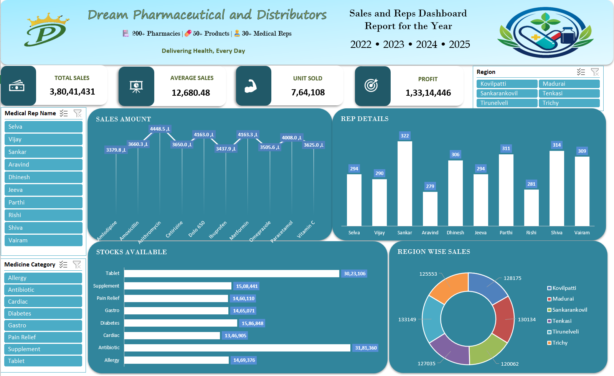

# Dream Pharmaceutical Sales & Inventory Analysis Dashboard

## Project Description

An interactive Microsoft Excel dashboard designed to analyze
pharmaceutical sales, medical representative activity, regional
performance, and medicine inventory. It summarizes key business metrics
and uses PivotTables, PivotCharts, and slicers to explore sales and
stock information across 2022--2025.

## Dashboard Preview



## Business Objectives

-   Monitor total sales, average sales, units sold, and profit.
-   Compare sales performance across regions and medicines.
-   Review medical representative activity.
-   Analyze stock availability by medicine category.
-   Explore the report using interactive filters.

## Dashboard Features

### Key Performance Indicators (KPIs)

-   **Total Sales** --- overall sales value.
-   **Average Sales** --- average sales metric displayed in the
    dashboard.
-   **Unit Sold** --- total quantity sold.
-   **Profit** --- overall profit value.

### Visual Analysis

-   **Sales Amount by Medicine:** compares sales amounts across
    medicines.
-   **Representative Details:** compares the activity values displayed
    for each medical representative.
-   **Stocks Available by Medicine Category:** compares stock
    availability across categories, including Tablet, Supplement, Pain
    Relief, Gastro, Diabetes, Cardiac, Antibiotic, and Allergy.
-   **Region-Wise Sales:** compares sales across Kovilpatti, Madurai,
    Sankarankovil, Tenkasi, Tirunelveli, and Trichy.

### Interactive Filters

Use the dashboard slicers to filter the report by: - Region - Medical
Rep Name - Medicine Category

The dashboard header presents the reporting years **2022, 2023, 2024,
and 2025**.

## Tools & Techniques

-   Microsoft Excel
-   PivotTables and PivotCharts
-   Interactive Slicers
-   KPI Reporting
-   Sales and Inventory Analysis
-   Data Aggregation
-   Data Visualization
-   Dashboard Design

## Project Structure

Organize the GitHub repository like this:

``` text
Dream-Pharma-Sales-Inventory-Dashboard/
├── README.md
├── Dashboard/
│   └── Dream-Pharma-Sales-Analysis.xlsx
└── Screenshots/
    └── Dream-Pharma-Dashboard.png
```

### Where to place each file

1.  Save this file as `README.md` in the **root folder** of the
    repository.
2.  Rename your Excel workbook to `Dream-Pharma-Sales-Analysis.xlsx` and
    place it in the `Dashboard/` folder.
3.  Save the dashboard screenshot as `Dream-Pharma-Dashboard.png` inside
    the `Screenshots/` folder.
4.  Keep the folder and file names consistent with the structure above
    so the preview image renders correctly on GitHub.

> **Note:** These are recommended repository file names. Rename your
> existing files to match them, or update the paths in this README to
> match the names you choose.

## How to Use

1.  Clone or download this repository.
2.  Open `Dashboard/Dream-Pharma-Sales-Analysis.xlsx` in Microsoft
    Excel.
3.  Use the Region, Medical Rep Name, and Medicine Category slicers to
    filter the dashboard.
4.  Review the KPI cards and charts to compare sales, representative
    activity, and stock availability.

## Key Takeaway

This project demonstrates how Excel-based data summarization and
visualization can turn pharmaceutical sales and inventory data into a
dashboard for performance monitoring and business analysis.

## Author

**Selva Sankar**
